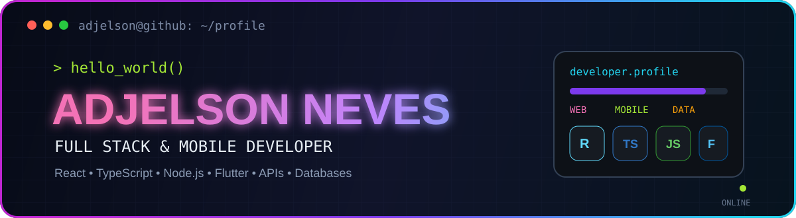
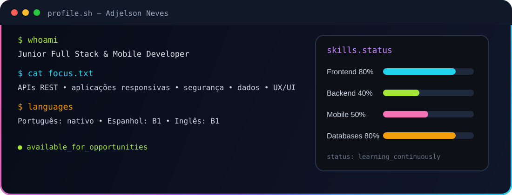

---

## `01. SOBRE_MIM`

Sou **Adjelson das Neves**, licenciado em **Engenharia Informática**, com experiência profissional em desenvolvimento Frontend e Full Stack de aplicações web institucionais.

O meu foco profissional é **Frontend com React e TypeScript**: criar interfaces claras, integrar APIs REST e desenvolver componentes reutilizáveis. Tenho também experiência em gestão de dados estatísticos, bases de dados relacionais e desenvolvimento mobile.

- **Frontend:** React, TypeScript, Next.js, Angular e Vue.js.
- **Full Stack:** integração de APIs REST, Node.js e bases de dados relacionais.
- **Forma de trabalhar:** atenção à experiência do utilizador, code reviews e Agile/Scrum, com apoio de ferramentas de IA generativa, incluindo Claude Code.

---

## `02. STACK_TECNOLÓGICA`

### Foco em Frontend · React & TypeScript

React e TypeScript em destaque, com experiência em interfaces institucionais, integração de APIs e componentes reutilizáveis.

<strong>📦 Ver stack detalhada</strong>

 

| Área | Tecnologias |
|---|---|
| **Frontend** | React, Next.js, Angular, Vue.js, TypeScript, JavaScript, Tailwind CSS, Bootstrap |
| **Mobile** | Flutter, React Native, Expo, React Navigation, Zustand |
| **Backend** | Node.js, Express, Spring Boot, Laravel, PHP, REST APIs, JWT |
| **Dados** | PostgreSQL, MySQL, MariaDB, SQLite, Prisma ORM, SQL |
| **DevOps** | Docker, Git, GitHub, GitLab, Linux, Postman |
| **Qualidade** | Clean Code, testes, validação, segurança, acessibilidade e UX/UI |

---

## `03. PROJETOS_EM_DESTAQUE`

### 📊 SIGI — Sistema Integrado de Gestão de Inquérito

Aplicações institucionais para visualização e gestão de dados estatísticos de grande escala.

**O meu contributo:** desenvolvimento e otimização de aplicações para acompanhar dados em tempo real, com atenção à integridade da informação.

### 🗂️ Interfaces para os Registos e Serviços Notariais

Interfaces web para sistemas institucionais da Direção-Geral dos Registos e Serviços Notariais.

**O meu contributo:** criação de componentes reutilizáveis e otimização de interfaces, com foco na experiência do utilizador e no desempenho.

**Tecnologias:** Next.js, Vue.js, Tailwind CSS e Docker.

### 📝 Recolha digital de dados estatísticos

Questionários digitais para apoiar operações de recolha de dados no Instituto Nacional de Estatística.

**O meu contributo:** configuração de questionários em **CSPro e Field Maps** e otimização dos fluxos de trabalho de recolha.

---

## `04. GITHUB_DASHBOARD`

---

## `05. EXPERIÊNCIA`

### Desenvolvedor Full Stack · Instituto Nacional de Estatística
**Setembro de 2025 — Maio de 2026**

Desenvolvimento e otimização de aplicações SIGI para visualização e gestão de dados estatísticos de grande escala, incluindo acompanhamento em tempo real e integridade dos dados.

### Desenvolvedor Front-End · Direção-Geral dos Registos e Serviços Notariais
**Fevereiro de 2025 — Setembro de 2025**

Criação de interfaces e componentes reutilizáveis com **Next.js, Vue.js e Tailwind CSS**, em aplicações integradas em Docker. Trabalho orientado à melhoria da experiência do utilizador e do desempenho dos sistemas institucionais.

### Consultor de TI · Instituto Nacional de Estatística
**Abril de 2024 — Dezembro de 2024**

Configuração de questionários digitais em **CSPro e Field Maps**, com otimização dos fluxos de recolha de dados.

### Estágio em Helpdesk · Instituto Nacional de Estatística
**Dezembro de 2023 — Abril de 2024**

Manutenção de equipamentos informáticos, instalação de software e resolução de problemas técnicos.

<strong>🎓 Formação, certificações e idiomas</strong>

- **Licenciatura em Engenharia Informática** · Faculdade de Ciências e Tecnologia, USTP · 2021–2025.
- **Erasmus+ em Engenharia** · Instituto Politécnico de Beja · Fevereiro–Julho de 2025.
- **JavaScript Essentials** · Cisco Networking Academy.
- **Artificial Intelligence Fundamentals** · IBM SkillsBuild.
- **Idiomas:** Português nativo · Espanhol profissional · Inglês intermédio/B1 (comunicação técnica).

---

## `06. CONTACTO`

### Vamos construir algo útil? 🚀

Estou disponível para colaborar em projetos web e mobile, integrar equipas de desenvolvimento e enfrentar novos desafios profissionais.

 

